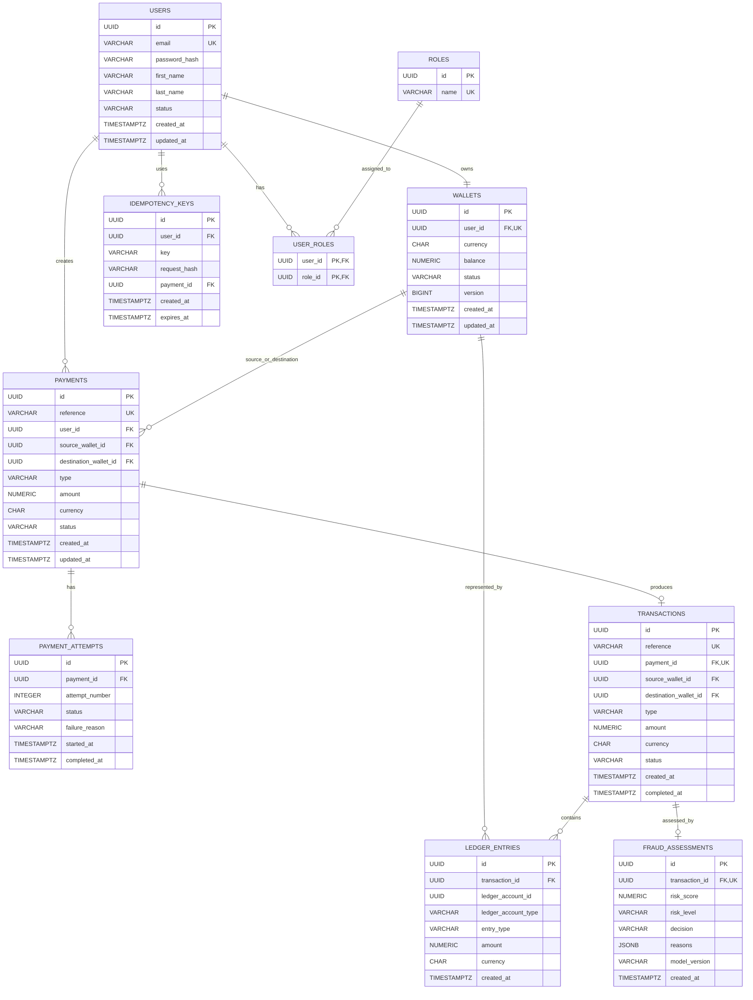

# PayFlow — Entity Relationship Diagram

## 1. Overview

This document describes the current PayFlow database model after Phase 10.

PayFlow uses PostgreSQL as the authoritative source of truth for financial state.

The current model contains:

- **User** — account owner and identity
- **Role** — authorization role
- **Wallet** — current operational balance
- **Payment** — business operation/request
- **Payment Attempt** — processing attempt for a payment
- **Transaction** — financial event resulting from a payment
- **Ledger Entry** — immutable accounting movement
- **Idempotency Key** — protection against duplicate client requests
- **Fraud Assessment** — risk analysis associated with a transaction

Phase 10 evolves the ledger from direct wallet ownership to an explicit **ledger account** model.

---

# 2. Entity Relationship Diagram



> **Note:** `ledger_entries.ledger_account_id` is a logical accounting-account identifier. Wallet ledger accounts use the corresponding wallet UUID, while external funding/settlement accounts use stable predefined identifiers. `ledger_account_type` identifies the account category.

---

# 3. Relationship Summary

```text
User
 |
 +---- 1:1 ---- Wallet
 |
 +---- 1:N ---- Payment
 |
 +---- 1:N ---- Idempotency Key
 |
 +---- M:N ---- Role
              via User Role

Wallet
 |
 +---- 1:N ---- Payment participation
 |
 +---- 1:N ---- Ledger Entries
       (through ledger account identity)

Payment
 |
 +---- 1:N ---- Payment Attempt
 |
 +---- 1:0..1 ---- Transaction

Transaction
 |
 +---- 1:N ---- Ledger Entry
 |
 +---- 1:0..1 ---- Fraud Assessment
```

---

# 4. User and Authorization Model

## User → Wallet

```text
User 1 ---- 1 Wallet
```

In the MVP, each user owns one wallet.

The database enforces unique wallet ownership through the unique `wallets.user_id` constraint.

---

## User → Payment

```text
User 1 ---- N Payments
```

A user can initiate multiple payments.

The payment stores the user responsible for the business operation.

---

## User ↔ Role

```text
User M ---- N Role
```

The many-to-many relationship is implemented through:

```text
USER_ROLES
```

with:

```text
(user_id, role_id)
```

as the composite primary key.

---

# 5. Wallet and Payment Model

A wallet can participate in multiple payments.

A payment can contain:

```text
source_wallet_id
destination_wallet_id
```

The application determines which fields are valid for each payment type.

### Transfer

```text
Wallet A
   |
   | source
   v
Payment
   |
   | destination
   v
Wallet B
```

### Deposit

```text
External Funding
       |
       v
Payment
       |
       v
Wallet A
```

### Withdrawal

```text
Wallet A
   |
   v
Payment
   |
   v
External Settlement
```

The external accounts are accounting concepts represented by ledger account identifiers; they are not application wallets.

---

# 6. Payment → Payment Attempt

```text
Payment 1 ---- N Payment Attempts
```

A payment represents the overall business operation.

An attempt represents one processing attempt.

Example:

```text
Payment P001

Attempt 1 -> FAILED
Attempt 2 -> FAILED
Attempt 3 -> COMPLETED
```

The database enforces uniqueness of:

```text
(payment_id, attempt_number)
```

---

# 7. Payment → Transaction

```text
Payment 1 ---- 0..1 Transaction
```

A failed or cancelled payment does not necessarily produce a completed financial transaction.

In the MVP, `transactions.payment_id` is unique, so one payment can produce at most one transaction.

Conceptually:

```text
Payment
   |
   +---- FAILED
   |       |
   |       +---- no completed transaction
   |
   +---- COMPLETED
           |
           v
       Transaction
```

---

# 8. Transaction → Ledger Entries

```text
Transaction 1 ---- N Ledger Entries
```

A transaction represents the financial event.

Ledger entries represent the accounting movements caused by that event.

For a transfer:

```text
Transaction T001
       |
       +---- DEBIT  Wallet A  ₹1,000
       |
       +---- CREDIT Wallet B  ₹1,000
```

For a deposit:

```text
Transaction T002
       |
       +---- DEBIT  External Funding Account  ₹1,000
       |
       +---- CREDIT Wallet A                  ₹1,000
```

For a withdrawal:

```text
Transaction T003
       |
       +---- DEBIT  Wallet A                   ₹1,000
       |
       +---- CREDIT External Settlement Account ₹1,000
```

---

# 9. Ledger Account Model

Phase 10 introduces explicit ledger-account ownership.

The domain model uses:

```text
LedgerAccountId
LedgerAccountType
```

For wallet accounts:

```text
LedgerAccountId   = WalletId
LedgerAccountType = WALLET
```

External financial movements use stable predefined ledger-account identifiers and their corresponding account type.

This allows the accounting model to represent both:

```text
Application wallet accounts
```

and:

```text
External funding / settlement accounts
```

without pretending that every accounting account is a user wallet.

---

# 10. Ledger Entry Model

A ledger entry contains the accounting information required to explain a financial movement:

```text
LedgerEntry
 |
 +-- id
 +-- transaction_id
 +-- ledger_account_id
 +-- ledger_account_type
 +-- entry_type
 +-- amount
 +-- currency
 +-- created_at
```

Entry types are:

```text
DEBIT
CREDIT
```

Amounts are always positive.

The direction of the movement is represented by `entry_type`, not by a negative amount.

---

# 11. Double-Entry Invariant

Every completed financial transaction must balance:

```text
Total DEBIT = Total CREDIT
```

Example:

```text
Transaction T001

DEBIT   Wallet A   ₹1,000
CREDIT  Wallet B   ₹1,000

Total Debit  = ₹1,000
Total Credit = ₹1,000
```

The same principle applies to deposits and withdrawals.

This is a cross-row accounting invariant and is enforced by ledger posting logic, transaction boundaries, tests, and reconciliation rather than a simple row-level CHECK constraint.

---

# 12. Ledger Immutability

Ledger entries represent historical accounting facts.

Once posted:

```text
UPDATE -> blocked
DELETE -> blocked
```

The design protects immutability at two levels:

```text
Application/domain layer
        +
Database layer
```

V3 adds database-level protection against modifying or deleting ledger entries.

This protects the accounting history against accidental ORM updates and direct database changes.

---

# 13. Wallet Balance vs Ledger

The wallet and ledger answer different questions.

### Wallet

```text
wallets.balance
        |
        v
Current operational balance
```

### Ledger

```text
ledger_entries
        |
        v
Historical accounting movements
```

For example:

```text
Wallet balance = ₹9,000

Ledger:
    CREDIT ₹10,000
    DEBIT  ₹1,000
```

The wallet balance represents current state, while the ledger explains the financial movements that produced that state.

---

# 14. Wallet Reconciliation

Wallet reconciliation compares:

```text
Wallet.balance
```

with the balance derived from ledger entries belonging to that wallet's ledger account.

Conceptually:

```text
Ledger Credits
     -
Ledger Debits
     =
Ledger-derived balance
```

Then:

```text
Ledger-derived balance
          |
          v
     compare with
          |
          v
Wallet.balance
```

A mismatch indicates that the operational wallet state and accounting history require investigation.

---

# 15. Transactional Consistency

A financial operation must be atomic.

Conceptually:

```text
Payment state
     +
Transaction
     +
Wallet balance
     +
Ledger entries
```

must succeed or fail together within the appropriate database transaction boundary.

If ledger posting fails, the financial operation must roll back rather than leaving partial state.

Phase 10 includes automated tests that verify transactional rollback behavior.

---

# 16. Idempotency

The idempotency relationship is:

```text
User 1 ---- N Idempotency Keys
```

An idempotency key identifies one logical client operation for a user.

Example:

```text
POST /api/payments
Idempotency-Key: ABC123
```

The database uniqueness boundary is:

```text
(user_id, key)
```

The request hash detects reuse of the same key with a different request payload.

The key also references the payment associated with the original operation.

---

# 17. Fraud Assessment

A transaction can have one fraud assessment in the current MVP:

```text
Transaction 1 ---- 0..1 Fraud Assessment
```

The assessment stores:

```text
risk_score
risk_level
decision
reasons
model_version
```

The `reasons` field uses PostgreSQL `JSONB`.

Fraud analysis supports the payment workflow but does not directly own financial state changes.

---

# 18. Complete Financial Flow

The central PayFlow flow is:

```text
User
  |
  v
Wallet
  |
  v
Payment
  |
  +---- Payment Attempts
  |
  v
Transaction
  |
  +---- Fraud Assessment
  |
  v
Ledger Entries
  |
  v
Ledger Accounts
```

For a transfer:

```text
User A
  |
  v
Wallet A
  |
  v
Payment
  |
  v
Transaction
  |
  +----------------------+
  |                      |
  v                      v
DEBIT Wallet A      CREDIT Wallet B
```

For a deposit:

```text
External Funding
       |
       v
Transaction
       |
       +----------------------+
       |                      |
       v                      v
DEBIT External        CREDIT Wallet A
```

For a withdrawal:

```text
Wallet A
   |
   v
Transaction
   |
   +-----------------------------+
   |                             |
   v                             v
DEBIT Wallet A        CREDIT External Settlement
```

Every completed operation must remain balanced.

---

# 19. Entity Responsibilities

| Entity | Responsibility |
|---|---|
| `users` | Identity and account ownership |
| `roles` | Authorization roles |
| `user_roles` | User-role assignments |
| `wallets` | Current operational wallet state |
| `payments` | Business operation/request |
| `payment_attempts` | Payment processing attempts |
| `transactions` | Financial event |
| `ledger_entries` | Immutable accounting history |
| `idempotency_keys` | Duplicate-request protection |
| `fraud_assessments` | Transaction risk analysis |

Ledger accounts are represented in the ledger domain rather than as a separate `ledger_accounts` table in the current schema.

---

# 20. Migration History

The current database schema evolves through three migrations:

```text
V1__initial_schema.sql
        |
        v
Initial PayFlow relational schema

V2__ledger_account_model.sql
        |
        v
Explicit ledger-account ownership

V3__ledger_immutability.sql
        |
        v
Database-level ledger immutability
```

The migration files are authoritative and should not be rewritten as part of documentation maintenance.

---

# 21. Phase 10 ERD Checkpoint

Phase 10 establishes the ledger as a first-class accounting component.

The current model supports:

- explicit ledger account identity
- wallet ledger accounts
- external funding/settlement accounts
- double-entry accounting
- immutable ledger history
- transactional rollback
- wallet reconciliation
- internal ledger read access

The diagram intentionally describes the current implementation rather than speculative future microservice/database boundaries.
